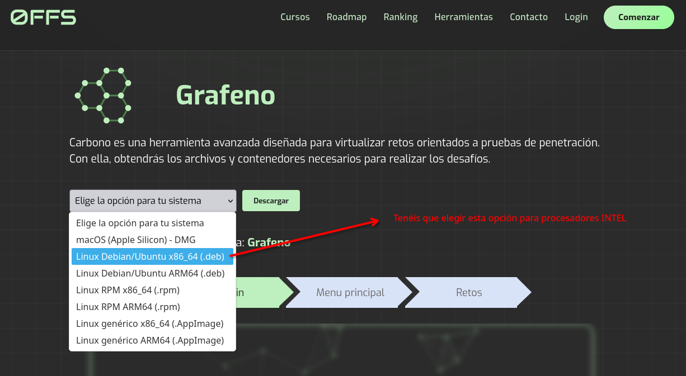
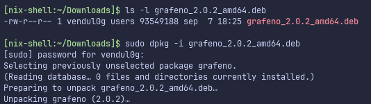
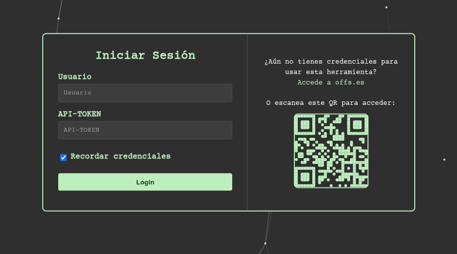
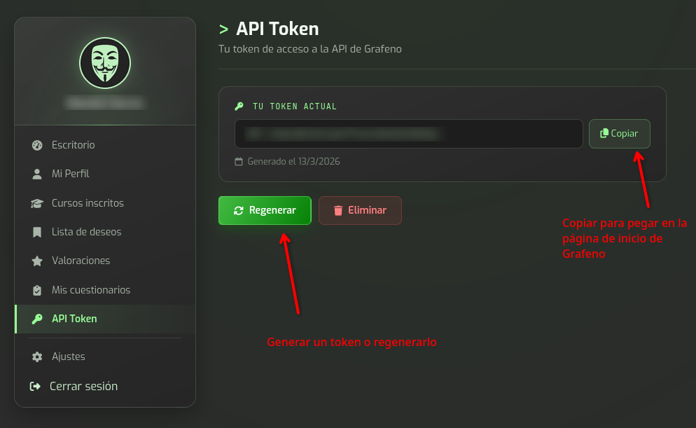
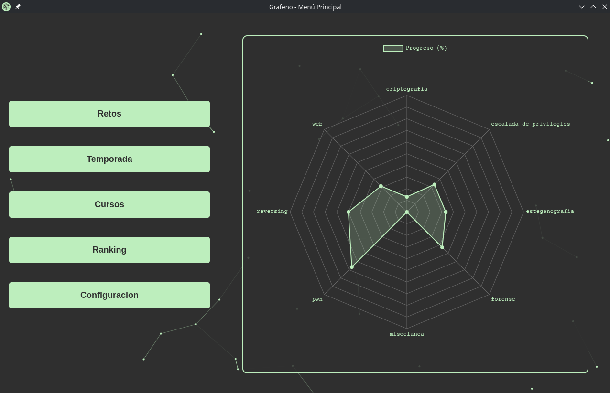
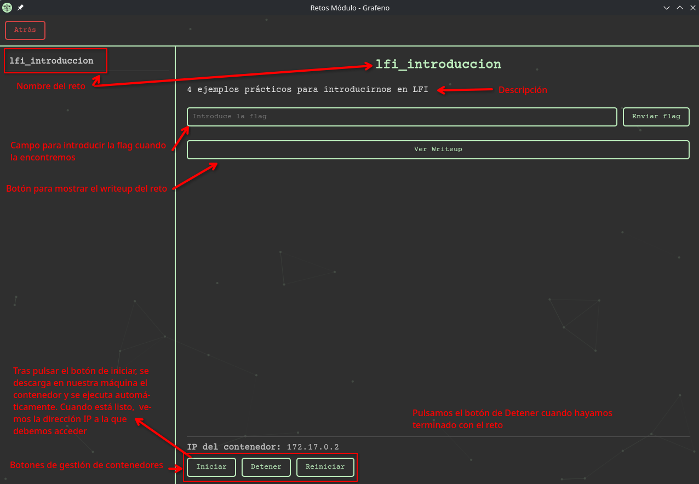

[Español](./install_grafeno.md) | [English](./install_grafeno_EN.md)

# Instalación de Grafeno

[Instalar Grafeno: disponible en la página de Offensive Skills](https://offs.es/tools)

Descargamos el binario desde la [página de Herramientas de Offensive Skills](https://offs.es/tools).



Cuando hemos descargado el fichero `.deb` lo siguiente que tenemos que hacer es instalarlo con el siguiente comando:

```
sudo dpkg -i grafeno_2.0.2_amd64.deb
```



Una vez que tenemos eso instalado, porque termina la ejecución del comando, podemos abrir Grafeno directamente ejecutando en una terminal el comando `grafeno` (o buscando en las aplicaciones del sistema).

Cuando abrimos Grafeno por primera vez, encontramos la siguiente ventana:



Tenemos que introducir nuestro:

- Nombre de usuario
- API-Token

Para ello, debemos primero [**registrarnos en la página web de Offensive Skills**](https://offs.es/register). Una vez ahí, rellenamos el formulario de registro y validamos con el email. El siguiente paso es [**acceder a la página de API-Token**](https://offs.es/dashboard/api-token) para generar uno nuevo.



Una vez generado el token, eso es lo que debemos introducir, junto con el nombre de usuario, en la plataforma de Grafeno.

Tras hacer login, vemos una ventana como en la siguiente imagen:



En ella, destacamos:

- **Retos**. Es la página con retos CTF tipo Jeopardy que hemos ido haciendo a lo largo de los años.
- **Cursos**. Es la parte **esencial en la formación**, ya que tienes las máquinas adecuadas para cada punto del aprendizaje de vulnerabilidades.

Para desplegar un reto, por ejemplo, de LFI. Debemos acceder al curso de LFI, y dentro de este, acceder a un módulo. Y una vez ahí, podremos interactuar con los botones de gestión de Docker para desplegar el contenedor, como se ve en la siguiente página:


